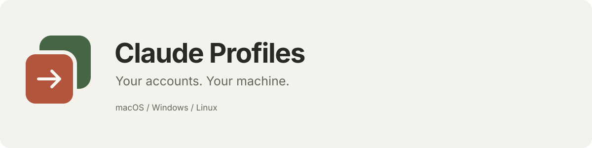
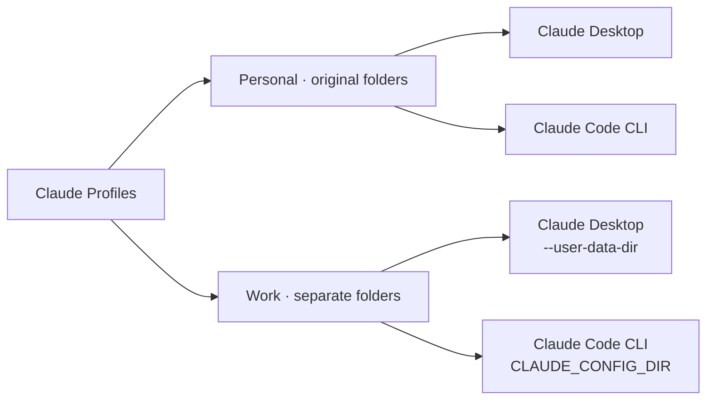

<p align="center">
  
</p>

<p align="center">
  <a href="https://github.com/MarcoBallotti/claude-profiles/actions/workflows/build.yml"></a>
  <a href="LICENSE"></a>
  <a href="https://github.com/MarcoBallotti/claude-profiles/releases"></a>
</p>

<p align="center">
  <strong>Personal, work, client. Give every Claude account its own space.</strong><br>
  A local, open-source launcher for Claude Desktop and Claude Code on macOS, Windows and Linux.
</p>

<p align="center">
  <a href="https://github.com/MarcoBallotti/claude-profiles/releases">Download</a> ·
  <a href="#get-started">Get started</a> ·
  <a href="#how-it-works">How it works</a> ·
  <a href="docs/README.it.md">Italiano</a> ·
  <a href="CONTRIBUTING.md">Contribute</a>
</p>

---

## Stop signing out to switch accounts

Claude Profiles opens the Claude applications already installed on your computer, using separate data folders for each profile. Keep your personal setup, add your work account, and choose the right one from the app or system tray.

**This is a desktop launcher, not a web shortcut, a Claude client, or an account service.** You bring your own accounts and installations. Desktop and the terminal require their own first-time sign-ins.

## What you can do

- **Keep accounts side by side.** Give each profile a name, a color and an optional label. Open Desktop, Code, or both.
- **Keep your current setup.** Personal points to the standard Claude folders. Nothing is moved or copied on first launch.
- **Open the right terminal.** Launch Claude Code in your home folder or a selected project. Copy a safely quoted command for another terminal.
- **Switch from the tray.** Open a profile without hunting for the main window.
- **Bring your preferences.** Selectively copy instructions, skills and supported preferences. Existing files and symlinks are skipped.
- **Import existing profiles.** Connect their folders in place. The earlier native macOS version’s registry is migrated automatically, preserving its paths and original file.
- **Remove without losing data.** Removing a profile only removes it from the list. Restore it from Settings.

## Download

Get the packages from [GitHub Releases](https://github.com/MarcoBallotti/claude-profiles/releases).

| Platform | Packages | Terminal integration |
| --- | --- | --- |
| macOS 13+ · Apple Silicon and Intel | `.dmg`, `.zip` | Terminal.app / zsh |
| Windows 10/11 · x64 | Setup `.exe`, portable `.exe` | Native PowerShell and `claude.exe` |
| Linux · x64 | `.AppImage`, `.deb` | GNOME Terminal, Konsole, Xfce Terminal, Kitty, Alacritty, xterm or the system terminal |

**Preview release:** packages and unit tests are built on all three operating systems. Interactive Claude sign-in flows have not been verified on every OS/install channel. Desktop multi-profile behavior is experimental and may change when Claude updates. Please report your OS, Claude version and installation channel with compatibility issues.

Mac bundles use ad-hoc signatures verified during the build; they are not signed with an Apple Developer ID or notarized. Windows builds are not code-signed. The operating system may ask you to confirm the publisher. Release checksums are provided in `SHA256SUMS.txt`.

Claude Desktop and Claude Code must be installed separately. Linux Desktop support follows the [official Claude Linux beta](https://code.claude.com/docs/en/desktop-linux), currently for Ubuntu 22.04+/Debian 12+. On other distributions, use Claude Code. Windows launches the native CLI, not a WSL installation.

## Get started

1. Install and open **Claude Profiles**.
2. Select **Personal → Open Desktop** to open the standard existing Claude setup.
3. Select **Work → Open Desktop**, then sign in with your work account.
4. If you also use the CLI, select **Open terminal** and sign into that profile there.
5. Next time, choose the profile from the app or tray menu. No routine logout/login cycle is needed.

You can use the **Code tab inside each Desktop window** as well as the separate terminal CLI, subject to your account’s plan and organizational settings.

If the browser suggests the wrong account, open the authentication link in a private window. If an OAuth callback returns to the wrong Claude instance, temporarily close the other Claude windows during the first sign-in. You do not need to sign out of those accounts.

**Application not detected?** Open Settings and choose Claude Desktop or the native Claude Code executable. Windows detection includes common install locations and Microsoft Store package manifests; package activation restrictions may still require manual configuration.

## How it works



The **Desktop data directory** stores that instance’s local app state. The **Code configuration directory** is passed to Desktop and the terminal for that profile. This does not transfer authentication between Desktop and CLI: each signs in separately, and Claude manages its own credentials.

The launcher does not inspect the OS credential store, extract tokens, proxy requests or synchronize conversations. Profile labels are supplied by you; they are not verified email addresses or plan information. “Open” describes a detected Desktop process, not a verified login.

### Data locations

| OS | Claude Profiles registry and managed profiles |
| --- | --- |
| macOS | `~/Library/Application Support/ClaudeProfiles` |
| Windows | `%APPDATA%\ClaudeProfiles` |
| Linux | `$XDG_CONFIG_HOME/ClaudeProfiles` or `~/.config/ClaudeProfiles` |

```text
ClaudeProfiles/
├── profiles-v2.json
├── profiles-v2.json.backup
├── Profiles/
│   └── <stable-profile-id>/
│       ├── Desktop/
│       └── Code/
└── Launchers/
```

Profiles use stable IDs: renaming one does not change its folders. The Personal profile leaves `CLAUDE_CONFIG_DIR` unset so the standard `~/.claude` and `~/.claude.json` behavior remains intact. If your personal setup already uses custom paths, import those folders instead.

### What preference copying includes

| Included, when selected | Always excluded |
| --- | --- |
| `CLAUDE.md`, skills, agents, commands, rules, output styles | Credentials, cookies and conversation history |
| A small allowlist of model, language, reasoning and display settings | Environment variables, hooks, permissions, MCP servers and plugins |

These are independent copies, not live links or a synchronization service. Review your custom instructions and skills before copying them into a work profile.

## Development

Use **Node.js 22.12+**. No API key, developer account or additional service is needed to build the launcher.

```sh
git clone https://github.com/MarcoBallotti/claude-profiles.git
cd claude-profiles
npm ci
npm start
```

```sh
npm run check     # JavaScript syntax and local-only CSP checks
npm test          # Core tests using temporary folders and harmless processes
npm run dist      # Native installers for the current OS, written to dist/
```

Build Windows packages on Windows, Linux packages on Linux, and macOS packages on macOS. GitHub Actions handles the four release targets: macOS arm64, macOS x64, Windows x64 and Linux x64.

For a manual preview that disables Claude launches and preference copying:

```sh
npm start -- --preview-root /absolute/path/to/disposable-data
```

On Windows use an absolute Windows path, for example `C:\Temp\claude-profiles-preview`. Do not point preview mode at an existing profile directory.

### Project layout

```text
src/core/       Profile storage, migration, launch plans and preference copying
src/launcher.mjs  Platform processes and installation detection
src/main.mjs    Electron lifecycle, validated IPC and native dialogs
src/preload.cjs Narrow renderer bridge
src/renderer/   Local HTML, CSS and JavaScript interface
test/           Cross-platform core tests
.github/        Native builds, tests and preview releases
```

The renderer has no Node integration and uses context isolation, sandboxing, blocked remote navigation and an offline Content Security Policy. Runtime code uses only Electron and Node built-ins. There are no analytics or background update checks in this launcher.

## Limitations worth knowing

- Desktop `--user-data-dir` is a compatibility mechanism, not an Anthropic-supported multi-account API.
- Separate folders are not a filesystem sandbox. Device-wide enterprise policies still apply.
- Claude Console sign-in without an API key may store authentication outside the profile directory. Third-party gateways and Bedrock/Vertex/Foundry setups need additional configuration.
- The launcher clears inherited authentication/provider variables for additional profiles to avoid accidentally using a personal API key. It does not rewrite shell configuration files.
- Different operating systems cannot share a folder of encrypted Desktop cookies. Sign in on each device.
- Linux needs a working desktop/keyring for persistent Desktop sign-in. Tray availability depends on the desktop environment; if unavailable, use the main window.

See [CONTRIBUTING.md](CONTRIBUTING.md) for contributions and [SECURITY.md](SECURITY.md) for private vulnerability reporting.

## License & acknowledgments

[MIT](LICENSE). Built by [MarcoBallotti](https://github.com/MarcoBallotti) and open to contributions.

Inspired by the workflow of [Claude Switch](https://claudeswitch.dev/), with an independent implementation and original artwork. Claude Profiles is not affiliated with or endorsed by Anthropic or Claude Switch, and does not bundle their applications. Claude is a trademark of Anthropic.

References: [multiple-account CLI authentication](https://code.claude.com/docs/en/authentication#log-in-with-multiple-accounts) · [Claude Code settings](https://code.claude.com/docs/en/settings) · [Electron security](https://www.electronjs.org/docs/latest/tutorial/security).
